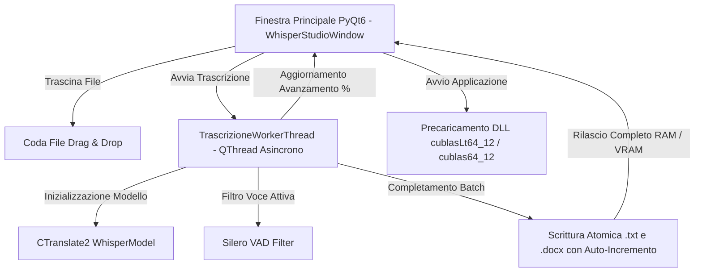

# Whisper Windows — Architettura & Funzionamento Tecnico

## 1. Stack Tecnologico
- **Linguaggio & Runtime:** Python 3.12 (64-bit) su Windows 10/11 (ambiente isolato `Windows/.venv`).
- **GUI Framework:** PyQt6 (interfaccia scura moderna e speculare alla versione macOS).
- **Motore Neurale:** **Faster-Whisper** basato su **CTranslate2**, libreria di inferenza C++ ad altissima efficienza.
- **Precaricamento Dinamico DLL:** Funzione `_preload_cuda_libraries()` che mappa le directory di ricerca e chiama `ctypes.CDLL` su `cublasLt64_12.dll` e `cublas64_12.dll` prima dell'importazione di `ctranslate2`.
- **Rilevamento VRAM Real-Time:** Interrogazione diretta di `nvml.dll` (`NVIDIA Management Library`) per visualizzare la memoria video effettivamente occupata.
- **Packaging:** PyInstaller con file spec `WhisperStudio.spec` (`--onedir` con eseguibile snello `WhisperStudio.exe` e cartella librerie `_internal`).

## 2. Flusso di Elaborazione & Threading

## 3. Gestione dei Modelli & Memoria
- Modelli predefiniti:
  - `Systran/faster-whisper-large-v3` (~3.08 GB).
  - `deepdml/faster-whisper-large-v3-turbo-ct2` (~1.6 GB).
- Modalità di calcolo:
  - GPU NVIDIA: `device="cuda"`, `compute_type="float16"`.
  - CPU Fallback: `device="cpu"`, `compute_type="int8"`.
- Memory Reclaim:
  Al termine della coda o in caso di stop, il modello CTranslate2 viene esplicitamente deallocato e invocato `gc.collect()`, liberando il 100% della memoria video VRAM e della RAM di sistema.

## 4. Verifica Aggiornamenti
- Worker non invasivo [`UpdateCheckWorker`](../whisper_studio.py) asincrono:
  - 1 controllo ritardato a 10 secondi dall'avvio.
  - Massimo 1 controllo ogni 24 ore memorizzato in `QSettings`.
  - Voce nel menu `Aiuto` ➔ `Verifica Aggiornamenti...` (`Check for Updates...`).
  - Dialogo `UpdateDialog` con changelog e download rapido del file `.zip`.
