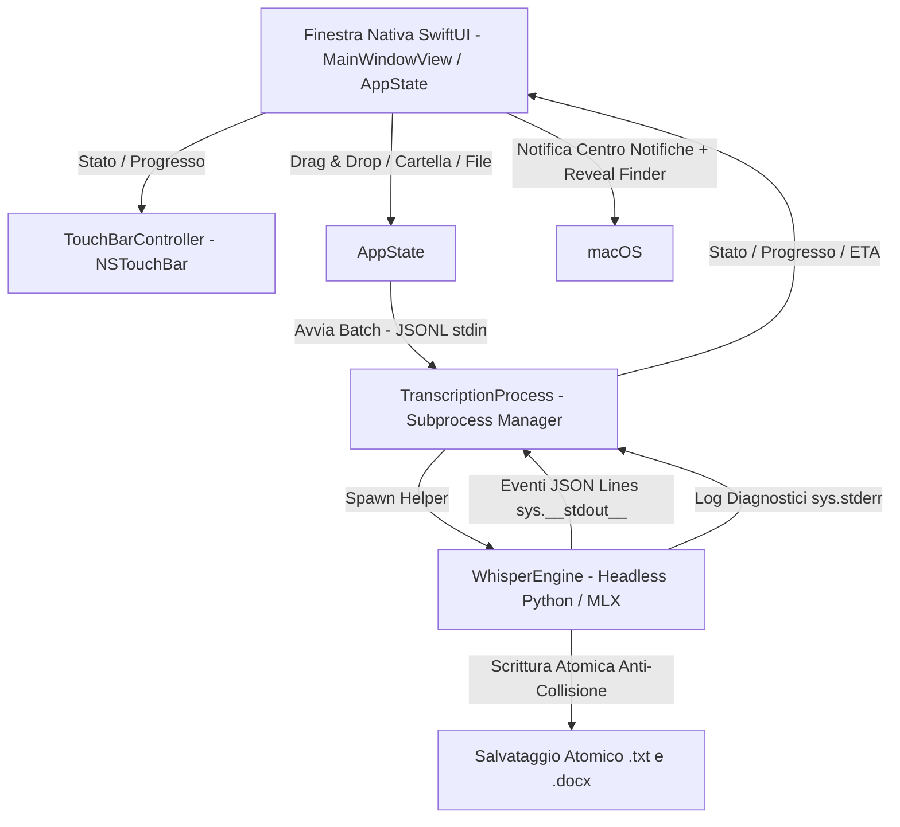

# Whisper MacOS — Architettura & Funzionamento Tecnico (v3.0.5)

## 1. Stack Tecnologico
- **Target Piattaforma:** macOS 26.0 Tahoe o successivo, Apple Silicon (`arm64`).
- **GUI Nativa (`macOS/App/`):** Swift 6 (`SwiftUI` + `AppKit`), compilata via Swift Package Manager con tema grigio zinco fisso ([`AppTheme.swift`](../App/Sources/Theme/AppTheme.swift)), finestra singola (`Window`) con menu bar essenziale, `@Observable`, `UserDefaults` (`AppPreferences`), `URLSession` (`UpdateCheckerService`), `UNUserNotificationCenter` (`NotificationService`) e `NSTouchBar` nativo (`TouchBarController`).
- **Motore Neurale Isolato (`macOS/Engine/`):** Processo headless Python 3 (`whisper_engine.py`) con Apple MLX (`mlx-whisper`), inferenza diretta su GPU Metal e memoria unificata.
- **Decoding Multimediale:** Binario FFmpeg `arm64` incluso nel bundle con caricamento streaming in memoria + opzioni CLI `--probe` (durata media) e `--check-cache` (verifica cache locale Hugging Face).
- **Packaging & Firma (`macOS/Scripts/`):** Script `build_and_install_app.sh` che compila `WhisperEngine` (`--onedir` PyInstaller, senza Qt/Tk) dentro `Contents/Resources/WhisperEngine/`, compila `WhisperStudio` (`arm64` release), firma inside-out tutti i binari e installa `/Applications/Whisper Studio.app`.

## 2. Flusso di Elaborazione & IPC JSON Lines

## 3. Gestione Memoria, Modelli & Controllo Esecuzione
- **Rilevamento RAM & Pressione Memoria:** [`SystemMemoryService.swift`](../App/Sources/Services/SystemMemoryService.swift) legge la RAM fisica tramite `ProcessInfo.processInfo.physicalMemory` (scelta automatica: ≥ 24 GB `Large-v3 Standard`, < 24 GB `Large-v3 Turbo`) e campiona `mach_host_statistics64` / `vm_statistics64` per la barra in tempo reale.
- **Modelli Supportati:**
  - `mlx-community/whisper-large-v3-mlx` (Standard).
  - `mlx-community/whisper-large-v3-turbo` (Turbo).
- **Controllo Cache Locale & Download Annullabile:** `AppState` verifica la cache locale di Hugging Face (`isActiveModelCached`) e `whisper_engine.py` la conferma (`is_model_locally_cached`); se il modello non è presente, l'UI mostra il pulsante **Scarica modello** (attivo anche a coda vuota, comando `download_model`) e durante il trasferimento `snapshot_download` con `_AbortableTqdm` nasconde *Pausa* mostrando esclusivamente **Annulla download**.
- **Pausa / Riprendi / Memory Reclaim:** Durante la trascrizione, `TranscriptionProcess` invia `SIGSTOP`/`SIGCONT` al gruppo processo helper mantenendo il conteggio esatto del tempo in pausa per non alterare velocità/ETA; al termine o annullamento, il motore invoca `mx.clear_cache()` e il sottoprocesso termina restituendo tutta la memoria al sistema.

## 4. Aggiornamenti Automatici Zero-Overhead
- [`UpdateCheckerService.swift`](../App/Sources/Services/UpdateCheckerService.swift) esegue un controllo non bloccante tramite `URLSession` su `https://api.github.com/repos/Ritolino/WhisperStudio/releases/latest` (rate-limit 24h, rinvio 24h *Più tardi*, ignora versione persistente e verifica manuale da menu `Aiuto`).
- [`UpdateDialogView.swift`](../App/Sources/Views/UpdateDialogView.swift) mostra icona nativa, confronto versioni SemVer, note di rilascio e collegamento diretto all'asset macOS (`.dmg`/`.zip`) con fallback su `html_url`.
